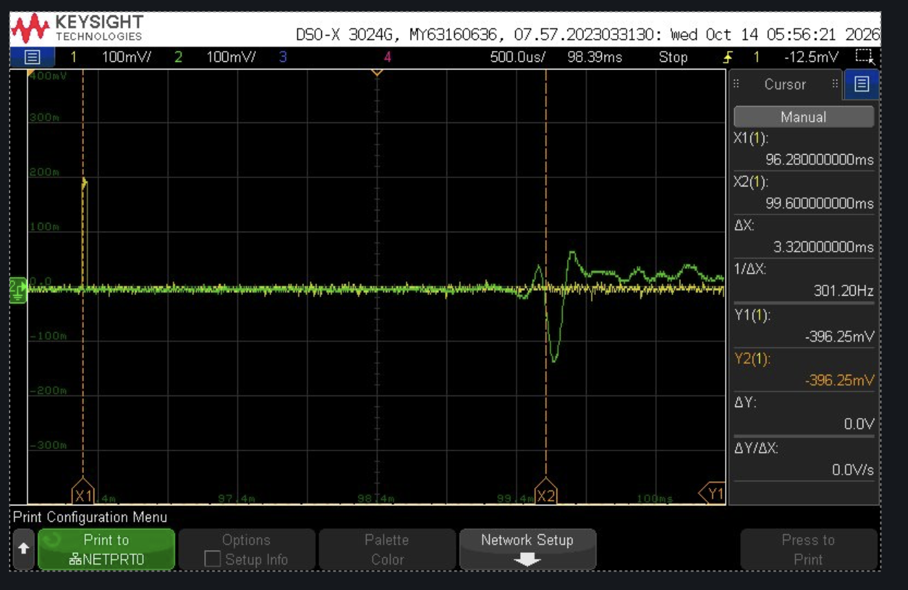

# Carrier board rev 1

KiCad project: [seed3-carrier-board](https://github.com/B1narySolutions/seed3-carrier-board) (`rev1/`).
Fabrication files: `fabrication/2026-09-15-e7ddc60/` in that repo.

## What's on the board
- Guitar input (1/4"), buffered, with an input-level pot
- Daisy Seed sockets (Seed Rev4 footprint)
- Headphone amp (TPA6111A2) on a 1/8" jack
- 1/4" line out, muted in hardware by the headphone jack's switch
- Volume and tone pots
- 4-pin display UART header
- 2-pin 5 V power header with P-FET reverse-polarity protection
- Test points: VREF, AMP_5V
- Size 95.8 x 66.2 mm, 2 layers

## Measurements

Add a row whenever you measure something. Say how you measured it.

| Date | What | Value | How | Who |
| --- | --- | --- | --- | --- |
| 2026 (fall) | Current draw at 5 V | ~200 mA | Benchtop supply set to 5 V, supply's current readout | Rocco |
| 2026-10-13 | Delay, guitar in to output | ~3.3 ms | Keysight DSO-X 3024G, impulse into the guitar input, cursors from impulse to the main output peak ([capture](images/rev1-impulse-latency.png)) | Rocco |
| 2026-10-13 | Output polarity | Inverted | Same capture: a positive impulse gives a negative main peak | Rocco |

## Audio phase and latency

**Measured (2026-10-13):** an impulse into the guitar input comes out about **3.3 ms** later, and **inverted**.
Cursors: 96.28 ms at the impulse, 99.60 ms at the output's main peak. Whether an amp model or the cab EQ was on
was not recorded; the slow wobble after the main peak may come from them.

**Reading the capture.** The small wiggles before the main peak are pre-ringing from the codec's digital
filters. For filters like these, the centre of the main peak marks the delay, not the first wiggle. The main
peak is negative and its side lobes are positive, so the inversion is real and not a ringing artefact.

**Why it's inverted.** The TPA6111A2 headphone amp is wired as an inverting amplifier with a gain of -1
(R9/R11 = 20k/20k). The line out is fed from its left output through the headphone jack's switch
(J5 TN to R3 to J2), so it is inverted too.

**Where the 3.3 ms comes from.** The analog parts add microseconds at most. The rest is:
- 1 ms collecting a 48-sample input block before the audio callback runs (libDaisy double-buffered DMA).
- 1 ms because the processed block plays out during the next DMA half.
- About 1.3 ms of ADC and DAC digital filter delay in the Seed's codec (the remainder; not checked against the datasheet).

The callback's compute time (~550 us) does not add to the delay as long as it finishes inside the 1 ms block.
Latency is about 2 x block size + codec delay, so 24-sample blocks would save about 1 ms.

**Analog phase shift** from the coupling caps and filters, worked out from the KiCad netlist (not measured).
It is small across the audio band:

| Stage | Parts | 100 Hz | 1 kHz | 10 kHz |
| --- | --- | --- | --- | --- |
| Input buffer | C3 1 uF into RV1 1M, TLV9062 follower | +0.1° | 0° | 0° |
| Output low-pass (48 kHz) | R2 3.3k, C2 1 nF | -0.1° | -1.2° | -11.7° |
| Output buffer | C5 1 uF, R6 1M, follower | +0.1° | 0° | 0° |
| Headphone amp input | C12 4.7 uF, R9 20k | +1.0° | +0.1° | 0° |
| Output cap, 32 ohm headphones | C14 470 uF, R13 100, R15 4.7 | +7.2° | +0.7° | +0.1° |
| Output cap, line out (10k+ load) | Same | +2.0° | +0.2° | 0° |
| **Total, headphones** | Plus the 180° inversion | 180° + 8° | 180° - 0.4° | 180° - 12° |
| **Total, line out** | Plus the 180° inversion | 180° + 3° | 180° - 0.9° | 180° - 12° |

**Measuring tip.** Use an impulse or a sharp edge. An earlier try with a plucked guitar note read 4.4 ms
because matching peaks on a note can slip by a whole cycle.

## Known issues
- No AUX input yet (required by the spec).
- 5 V header is unkeyed; it can be plugged in backwards (the P-FET protects the board).
- Display header carries 5 V and is unkeyed.
- No mounting holes.
- A mono plug in the headphone jack shorts the right channel through 4.7 ohms.
- Seed3 pinout vs the Rev4 footprint (VIN pin 39, audio pins 16-19) still needs confirming.

These are all on the [rev 2 list](rev2.md).
